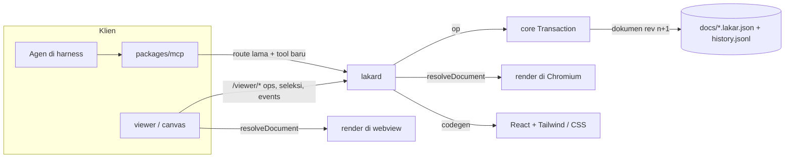
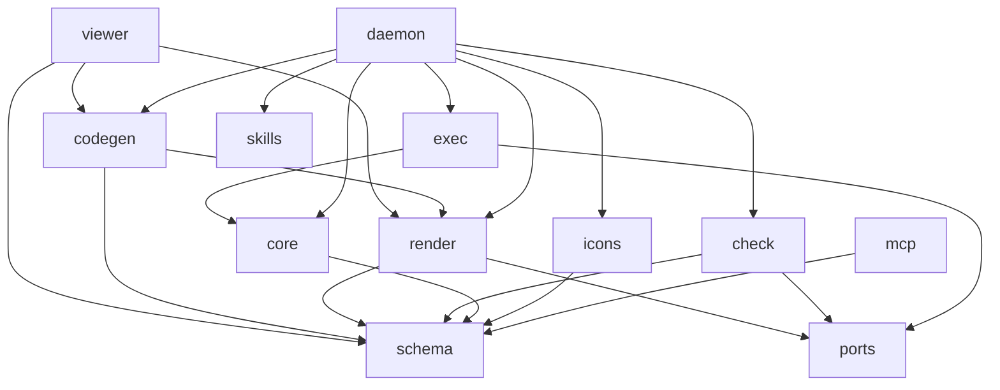
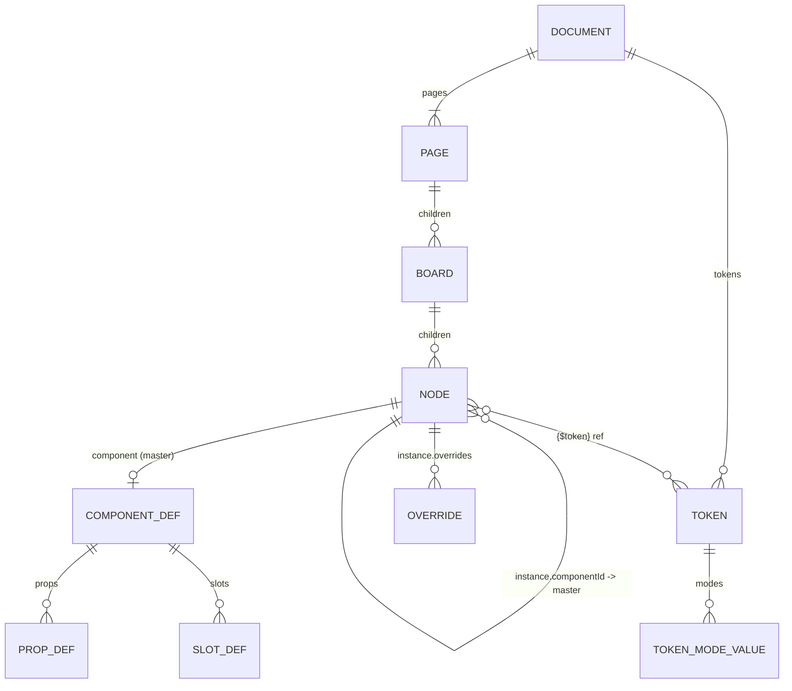
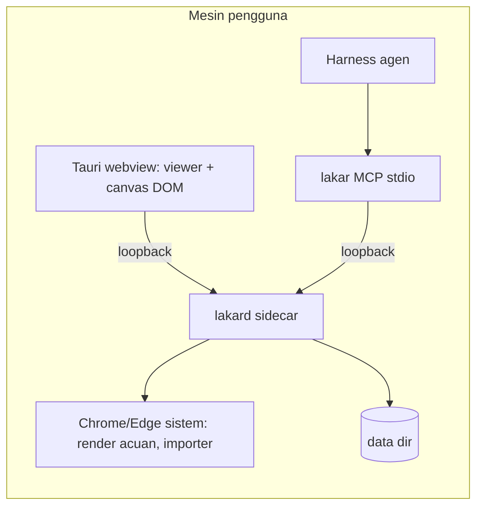

# Architecture Spine — Model dokumen Lakar

## Design Paradigm

**Functional core, imperative shell** di atas **satu model dokumen bertipe**.

- **Inti murni (tanpa IO):** `@lakar/schema` (bentuk + resolusi dokumen), `@lakar/core` (transaksi op + migrasi), `@lakar/render` (dokumen → DOM/CSS), `@lakar/check`, dan paket baru `@lakar/codegen` (dokumen → kode).
- **Shell:** `lakard` (`packages/daemon`) adalah satu-satunya pemilik file dokumen, sesi, render Chromium, dan importer. `packages/mcp` dan `packages/viewer` adalah klien.
- **Model:** pohon JSON milik Lakar yang **semantik propertinya adalah CSS**. Lakar tidak menyimpan HTML/CSS mentah, dan juga tidak memakai vektor abstrak.



## Invariants & Rules

### AD-1 — Model hibrida: JSON bertipe dengan semantik CSS

- **Binds:** all
- **Prevents:** epic editor menambah properti yang tidak punya padanan render atau ekspor, epic paste menyimpan HTML mentah, dan epic kode menafsirkan properti secara berbeda dari canvas.
- **Rule:**
  - Dokumen adalah pohon node bertipe dengan skema zod tertutup (`.strict()`) di `@lakar/schema`.
  - Setiap properti gaya berpadanan dengan properti dan nilai CSS yang terdefinisi.
  - Dokumen tidak boleh berisi string CSS bebas, peta `style` bebas, atau HTML mentah.
  - Node boleh membawa `tag` opsional (elemen semantik HTML, dari allowlist) untuk ekspor.
  - Format tetap milik Lakar (C3).

### AD-2 — Daemon pemilik state, satu jalur mutasi [ADOPTED]

- **Binds:** all
- **Prevents:** dua penulis dokumen (viewer, agen, importer) yang saling menimpa, dan perubahan yang tidak tercatat di riwayat.
- **Rule:**
  - Hanya `lakard` yang membaca dan menulis `<data>/docs`.
  - Setiap perubahan, dari agen, viewer, paste, token, maupun komponen, adalah op `Transaction` di `@lakar/core` yang di-commit di bawah `DocumentLocks`.
  - Satu commit menghasilkan satu `rev` dan satu entri riwayat.
  - Kemampuan tulis baru ditambahkan dulu sebagai op core, lalu diekspos di API `execute` dan di route ops viewer (AD-7). Tidak boleh ada jalur tulis lain.

### AD-3 — Versi skema dan korpus migrasi

- **Binds:** epic model-dokumen; epic 3–7 setiap kali mengubah skema
- **Prevents:** dokumen lama yang tidak bisa dibuka, dan dua epic yang menaikkan versi dengan arti berbeda.
- **Rule:**
  - Setiap perubahan skema yang bisa menggagalkan pembaca lama menaikkan `schemaVersion` tepat satu, dengan langkah `n → n+1` di `MIGRATIONS` (`packages/core/src/migrate.ts`). Karena skema `.strict()`, setiap kunci baru termasuk perubahan seperti ini.
  - Satu PR yang mengubah skema berisi tepat satu kenaikan versi. Nomor versi ditentukan saat merge ke `main`. PR lain yang juga menaikkan versi harus di-rebase, lalu langkah migrasinya dinomori ulang di atas versi terbaru.
  - Korpus `tests/fixtures/docs/v<n>/*.lakar.json` untuk setiap versi wajib bermigrasi, lolos validasi, dan lolos render di CI Linux.
  - Langkah migrasi bersifat murni, deterministik, dan tidak mengubah tampilan.

### AD-4 — Kompatibilitas mundur menggantikan pembekuan bench

- **Binds:** packages/mcp, route daemon lama, API `execute`, C5
- **Prevents:** agen yang sudah terpasang rusak diam-diam, sekaligus pembekuan total yang menghambat tujuan inisiatif ini.
- **Rule:**
  - Pembekuan demi bench dicabut.
  - Yang tetap dijaga:
    - nama tool MCP dan route lama;
    - input yang dulu valid tetap diterima, termasuk input node v2 dan nilai token datar lama di `setTokens`;
    - kode error dan status HTTP;
    - default config yang membuat config lama tetap berlaku.
  - Respons hanya boleh bertambah field.
  - Pesan dan hint error boleh diperbaiki. Tes yang memeriksa teks pesan diperbarui dalam PR yang sama.
  - Perubahan yang memutus kompatibilitas butuh persetujuan Fatmuh dan kenaikan versi mayor Lakar.
  - Route baru tetap di bawah `/viewer/*`, dengan guard Origin.

### AD-5 — Pemetaan CSS tunggal

- **Binds:** render, codegen, viewer (Copy as), importer
- **Prevents:** canvas, ekspor, dan Copy as menghasilkan nilai berbeda untuk properti yang sama. Contohnya `lineHeight`, `letterSpacing`, sudut gradien, dan padding, yang sekarang diduplikasi di `packages/viewer/src/copyas.ts`.
- **Rule:**
  - Satu modul murni di `@lakar/render` memetakan node menjadi deklarasi CSS. Mount DOM, `@lakar/codegen`, dan Copy as memakai modul ini.
  - Nilai literal dipetakan langsung. Ref `{$token}` dipetakan menjadi `var(--…)` (AD-11). Render selalu mengirim node ter-resolve, sedangkan codegen dan Copy as boleh mengirim node yang masih berisi ref.
  - Importer (AD-15) memakai tabel kebalikannya, yang berada di sebelahnya.
  - Properti skema baru masuk ke skema, pemetaan, dan tes golden dalam PR yang sama.

### AD-6 — Canvas DOM hidup, Chromium sebagai acuan piksel

- **Binds:** epic editor, epic agen di canvas, epic kode
- **Prevents:** renderer kedua di viewer, dan sengketa "mana yang benar" antara canvas dan ekspor.
- **Rule:**
  - Canvas viewer me-mount board dengan `@lakar/render`, pada dokumen yang sudah diproses `resolveDocument` (AD-10).
  - PNG dari daemon tetap dipakai untuk export, thumbnail, tool `screenshot`, dan pratinjau riwayat.
  - Render Chromium di daemon adalah acuan untuk uji piksel dan ekspor (R5). Canvas di webview Tauri (WebView2, WKWebView, WebKitGTK) boleh berbeda subpiksel.

### AD-7 — Route ops viewer dan gestur

- **Binds:** epic editor, epic token, epic komponen, epic paste
- **Prevents:**
  - viewer menyusun kode JavaScript untuk menulis, seperti `codegen.ts` sekarang;
  - commit per frame saat drag;
  - konflik `rev` yang menolak edit pengguna saat agen sedang menulis.
- **Rule:**
  - Viewer menulis lewat `POST /viewer/docs/:slug/ops`. Isinya daftar op JSON dengan bentuk dan validasi yang sama dengan op `Transaction`, dan satu permintaan menjadi satu commit.
  - Satu permintaan bersifat semua-atau-tidak-sama-sekali: bila satu op gagal, seluruh permintaan di-rollback dan error op pertama yang gagal dikembalikan.
  - Op dialamati dengan id dan diterapkan pada `rev` terbaru. Op hanya gagal bila id targetnya tidak ada (`NOT_FOUND`). Tidak ada penolakan berbasis `baseRev`.
  - Selama gestur (drag, resize, scrub nilai), viewer hanya menampilkan pratinjau lokal. Commit dilakukan sekali di akhir gestur.

### AD-8 — Undo dengan op invers

- **Binds:** epic editor, viewer, core
- **Prevents:** undo yang menghapus perubahan agen di antaranya. Undo hapus sekarang memakai restore rev.
- **Rule:**
  - Core mengembalikan op invers untuk setiap commit.
  - Tumpukan undo dan redo dipegang tiap jendela viewer, hanya untuk commit milik jendela itu. Undo dan redo dijalankan sebagai commit baru berisi op invers lewat route ops (AD-7).
  - Bila op invers gagal karena perubahan lain (misalnya node sudah dihapus agen), entri undo itu dibuang dan pengguna diberi tahu. Tidak ada undo sebagian.
  - Agen tidak memakai tumpukan undo viewer. Agen mengoreksi lewat `execute`.
    - Amandemen 2026-11-23 (`spec-agent-undo`): agen boleh membatalkan dan mengulang langkahnya sendiri lewat tool `undo`/`redo`. Tumpukannya per sesi di daemon dan memakai op invers yang sama. Daemon menolak bila ada rev lain sesudah langkah sesi itu (edit pengguna, agen lain, restore). Dalam keadaan itu agen tetap mengoreksi lewat `execute`.
  - Restore rev hanya untuk aksi History yang eksplisit, bukan untuk undo.

### AD-9 — Seleksi adalah state efemeral di daemon

- **Binds:** epic agen di canvas (R2), viewer, mcp
- **Prevents:** seleksi tersimpan ke file dokumen atau ke riwayat, dan agen membaca seleksi dari tempat yang berbeda dengan yang ditampilkan.
- **Rule:**
  - Viewer mengirim seleksi ke route `/viewer/*` baru.
  - Daemon menyimpan seleksi terakhir per dokumen hanya di memori.
  - Agen membacanya lewat tool MCP baru.
  - Perubahan seleksi disiarkan lewat `/viewer/events` yang sudah ada (`activityHub`).
  - Isi seleksi adalah alamat node (id, atau alamat komposit AD-12).

### AD-10 — Satu pipa resolusi dokumen

- **Binds:** daemon, viewer, check, codegen
- **Prevents:** setiap konsumen mengurai instance dan token sendiri, lalu hasilnya berbeda.
- **Rule:**
  - `resolveDocument(doc, { mode? })` di `@lakar/schema` adalah fungsi murni yang berjalan dua tahap: ekspansi instance (AD-12), lalu resolve token untuk mode aktif (AD-11).
  - Kedua tahap juga diekspor terpisah (`expandInstances`, `resolveTokens`). Tidak ada konsumen yang menulis ulang salah satu tahap.
  - Render, check, dan canvas viewer hanya menerima hasil `resolveDocument` lengkap.
  - Codegen menerima dokumen tersimpan (instance dan ref token utuh), supaya instance menjadi pemakaian komponen dan token menjadi `var(--…)` (AD-16). Ekspansi hanya dipanggil codegen bila memang perlu, lewat `expandInstances`.

### AD-11 — Token bertipe dengan mode tema

- **Binds:** epic token (R3), epic kode (R5), migrasi
- **Prevents:** token salah jenis terpasang di slot, nama variabel CSS yang berbeda antara Copy as, ekspor, dan impor, serta mode yang diterapkan di tingkat berbeda.
- **Rule:**
  - `tokens: Record<name, { type, value, modes?: Record<mode, value> }>`.
  - `type` adalah salah satu dari `color | radius | spacing | container | breakpoint | fontFamily | fontWeight | fontSize | lineHeight | letterSpacing`.
  - Referensi tetap `{$token: name}`.
  - Satu tabel jenis-slot ↔ tipe-token di `@lakar/schema` menentukan token mana yang boleh dipakai di slot mana. Aturan ini divalidasi saat commit.
  - Nama variabel CSS diturunkan satu fungsi: `--` + nama dengan titik diganti `-`. Fungsi ini dipakai juga oleh impor CSS variables.
  - Nama mode dideklarasikan sekali di dokumen (`tokenModes: string[]`), dan elemen pertama adalah mode default. Kunci `modes` pada token hanya boleh berasal dari daftar ini. Token tanpa nilai untuk suatu mode memakai `value`.
  - Mode dipilih per board (`themeMode`, default mode pertama) dan diwarisi seluruh isi board, termasuk instance. Detach berarti mengganti ref dengan nilai mode aktif.
  - Migrasi v2 menentukan tipe token dari jenis slot yang paling sering memakainya. Ref dari slot berjenis lain di-detach menjadi nilai literal. Token yang tidak dipakai mendapat tipe dari nilainya: hex menjadi `color`, string lain menjadi `fontFamily`, angka menjadi `spacing`.

### AD-12 — Komponen, instance, override, dan alamat komposit

- **Binds:** epic komponen (R4), epic editor, epic agen, epic kode, check
- **Prevents:** override tertimpa saat master berubah, dua cara mengalamati isi instance, dan isi instance yang disimpan terurai sehingga tidak ikut berubah bersama master.
- **Rule:**
  - **Master** adalah node anak mana pun (bukan board) yang membawa `component: { props, slots }`.
    - `props` berisi `{ name, type: text | boolean | enum, default, binds: [{ nodeId, prop }] }`.
    - `slots` menunjuk frame di dalam master.
  - **Instance** adalah tipe node baru `instance { componentId, props?, overrides?, slots? }`. Isinya tidak pernah disimpan dalam bentuk terurai.
  - `overrides` dikunci dengan `masterNodeId` + nama properti.
  - Node hasil ekspansi dialamati secara komposit: `<instanceId>/<masterNodeId>[/<masterNodeId>…]`. Alamat ini tidak disimpan.
  - Update ke alamat komposit diterjemahkan core menjadi override pada instance terluar.
  - Override yang node masternya sudah hilang diabaikan dan dilaporkan sebagai finding.
  - Siklus komponen ditolak.
  - Menghapus master yang masih punya instance akan men-detach semua instance itu dalam commit yang sama. Setiap instance diganti node biasa ber-id baru, dengan props dan override sudah diterapkan.
  - API baca `execute` (`get`, `find`) mengembalikan node tersimpan. Isi instance dibaca lewat `get` dengan alamat komposit.
  - Komponen hanya berlaku di dalam satu dokumen.

### AD-13 — Kosakata layout

- **Binds:** epic editor (R1), epic paste, epic kode
- **Prevents:** properti baru dinamai sesuka tiap epic, dan responsif dimodelkan dengan dua cara.
- **Rule:**
  - Nama yang sudah ada dipertahankan: `layout row|column|none`, `gap`, `align`, `justify`, `padding`, `width|height: number|hug|fill`.
  - Properti baru memakai nama properti CSS dalam camelCase, dengan nilai bertipe. Contohnya `layout: 'grid'` + `gridTemplateColumns: Track[]` (`px | fr | auto | minmax`) dan `flexWrap`.
  - Varian responsif adalah board terpisah per lebar. Dokumen tidak berisi media query.

### AD-14 — Vektor

- **Binds:** epic paste/vektor (R6, R7), render, codegen
- **Prevents:** atribut SVG hilang saat diimpor lalu diekspor ulang, dan dua format simpan path.
- **Rule:**
  - `d` (sintaks path SVG) tetap menjadi format simpan node `path`.
  - Atribut presentasi SVG dipetakan ke properti bertipe. Contohnya `fillRule`, `strokeLinecap`, `strokeLinejoin`, `strokeDasharray`, dan `strokeMiterlimit`.
  - Atribut yang belum dipetakan disimpan di `svg: Record<attr, string>`, terbatas pada allowlist atribut presentasi di `@lakar/schema`.
  - SVG multi-path diimpor menjadi `frame` berisi node `path`.
  - Editor mengurai `d` saat edit lalu menulisnya kembali sebagai `d`.

### AD-15 — Satu importer paste di daemon

- **Binds:** epic paste/vektor (R6), mcp
- **Prevents:** importer terpisah di viewer dan di MCP yang menghasilkan layer berbeda, serta HTML dari luar yang dijalankan atau tersimpan.
- **Rule:**
  - HTML dirender di halaman Chromium terisolasi: JavaScript mati dan jaringan diblokir. Computed style lalu dibaca dan dipetakan ke skema lewat tabel kebalikan AD-5.
  - SVG diurai sesuai AD-14.
  - Yang tidak terpetakan dibuang dan dilaporkan.
  - Hasilnya adalah `NodeInput` yang di-commit lewat op core (AD-2).
  - Viewer dan MCP memanggil importer yang sama.

### AD-16 — Satu generator kode

- **Binds:** epic kode (R5), viewer, daemon
- **Prevents:** ekspor di viewer dan di daemon yang berbeda hasil, dan master komponen yang diekspor sebagai salinan statis.
- **Rule:**
  - Paket murni baru `@lakar/codegen` (deps: `schema`, `render`) menghasilkan React + Tailwind atau React + CSS dari pemetaan AD-5.
  - Token menjadi `var(--…)` (AD-11).
  - Master menjadi komponen React: props menjadi props, slot menjadi props bertipe `ReactNode`.
  - Instance menjadi pemakaian komponen beserta props dan override-nya.

### AD-17 — Arah dependensi

- **Binds:** all (ditegakkan `tests/dependency-direction.ts`)
- **Prevents:** viewer menarik `core`, `exec`, atau `icons`, dan paket murni menyentuh IO.
- **Rule:**
  - `EDGES` diperbarui sesuai diagram ini.
  - `codegen` dan `render` masuk `IO_FORBIDDEN`.
  - `render` tetap hanya memakai `import type` dari luar paket, karena dist-nya dimuat apa adanya di Chromium.



## Consistency Conventions

| Concern | Convention |
| --- | --- |
| Nama properti skema | Nama lama dipertahankan. Properti baru memakai nama properti CSS dalam camelCase (AD-13). Tipe node baru memakai kata benda Inggris huruf kecil (`instance`). |
| ID dan alamat | ID tersimpan: 8 karakter `[A-Za-z0-9]` dari `IdAllocator`. Alamat turunan instance: komposit dengan `/` (AD-12). Nama dan path tidak pernah menjadi alamat op. |
| Token | Nama bertitik huruf kecil (`colors.text-primary`). Variabel CSS `--colors-text-primary` (AD-11). |
| Error | `LakarError` dengan kode dari `packages/schema/src/errors.ts`. Kode baru hanya ditambahkan, kode lama tidak diubah artinya (AD-4). |
| Respons HTTP | Bentuk `{ok, data}` atau `{ok:false, error:{code, message, hint}}`, sama untuk route baru. |
| Event live | Hanya lewat `/viewer/events` dan `activityHub`. Jenis event baru ditambahkan, tidak membuka `EventSource` kedua. |
| Bahasa | Komentar dan dokumen dalam bahasa Indonesia. Teks UI, pesan commit, dan PR dalam bahasa Inggris. Pesan error agen mengikuti bahasa yang sudah dipakai. |
| Desain UI | Spine ini tidak menetapkan UI. Setiap layar mengikuti `design/lakar-ui.pen` (C6). |

## Stack

Seed, dari `package.json` repo per 2026-11-22. Spine ini tidak menambah teknologi baru.

| Name | Version |
| --- | --- |
| Node.js | >= 26 |
| pnpm | 12.21.0 |
| TypeScript | 7.0.2 |
| zod | 4.6.7 |
| fastify | 5.12.8 |
| playwright-core | 1.65.1 |
| quickjs-emscripten | 0.32.0 |
| @modelcontextprotocol/server | 2.4.0 |
| React | 19.3.1 |
| Vite | 8.3.8 |
| vitest | 5.1.0 |

## Structural Seed

Entitas dokumen setelah perluasan (hanya nama dan relasi):



Lingkungan berjalan tidak berubah: lokal, satu pengguna, tanpa akun (C2). `lakard` hanya mendengarkan di `127.0.0.1:7466`, sebagai sidecar desktop Tauri atau service di VPS. Data ada di `<data>/docs`, dan CI Linux adalah acuan.



Paket dan fixture baru:

```text
packages/
  codegen/                 # AD-16, murni
  render/src/css.ts        # AD-5, pemetaan node -> deklarasi CSS (+ tabel kebalikan)
  schema/src/resolve.ts    # AD-10, resolveDocument (ekspansi instance + token)
tests/fixtures/docs/v1..vN # AD-3, korpus migrasi
```

## Capability → Architecture Map

| Capability / Area | Lives in | Governed by |
| --- | --- | --- |
| R1 editor canvas | viewer (canvas DOM, gestur, panel), route ops daemon, op core | AD-2, AD-5, AD-6, AD-7, AD-8, AD-13 |
| R2 agen di canvas | mcp (tool seleksi), daemon (seleksi, events), API `execute` | AD-2, AD-4, AD-9, AD-12 (alamat komposit) |
| R3 token dan tema | schema (token, tabel slot), core (op token), migrasi | AD-3, AD-10, AD-11 |
| R4 komponen | schema (`component`, `instance`, `resolveDocument`), core (op override) | AD-10, AD-12 |
| R5 ekspor dan impor kode | codegen, render css.ts, daemon (export, impor CSS variables) | AD-5, AD-6, AD-11, AD-16 |
| R6 paste HTML/SVG | daemon importer, render tabel kebalikan | AD-1, AD-14, AD-15 |
| R7 vektor | schema `path` + `svg`, viewer editor path | AD-14 |
| Migrasi dokumen lama | core `MIGRATIONS`, `tests/fixtures/docs` | AD-3, AD-11 |
| Kompatibilitas klien lama | daemon route lama, mcp tool lama | AD-4 |

## Deferred

- **Teks kaya** (span inline dengan gaya berbeda dalam satu `text`). R1 hanya butuh edit isi teks. Diputuskan di epic editor bila panel tipografi membutuhkannya.
- **Komponen lintas file, kit, shadcn, dan komponen kode dari codebase di canvas.** Di luar cakupan awal (brief: coming soon/in progress di Paper).
- **Tipe prop selain `text | boolean | enum`** (instance swap). Ditambah di epic komponen bila dibutuhkan, lewat AD-3.
- **Ambang selisih piksel R5.** Diputuskan epic kode, diukur terhadap acuan Chromium (AD-6).
- **Gaya kondisional per breakpoint.** Responsif tetap board terpisah (AD-13). Token `breakpoint` hanya diekspor sebagai variabel dan screens Tailwind.
- **Anggaran performa canvas DOM** (jumlah node, FPS). Ditetapkan epic editor.
- **Detail parser impor CSS variables** (format sumber yang didukung). Milik epic kode, tetapi nama token tetap mengikuti AD-11.
- **Salin token antar-file dan ke file CSS** (brief §Token). Dibangun di epic token di atas keluaran CSS codegen dan impor CSS variables, tanpa format pertukaran baru.
- **Korpus migrasi.** Dokumen v1/v2, termasuk dokumen bench lama, ada di data dir lokal dan VPS, bukan di repo. Story migrasi pertama mengumpulkan dan menyamarkannya. Menjadi blocker story itu, bukan blocker spine.
- **Akun, kolaborasi, dan sinkron multi-pengguna.** Di luar inisiatif (C2).
